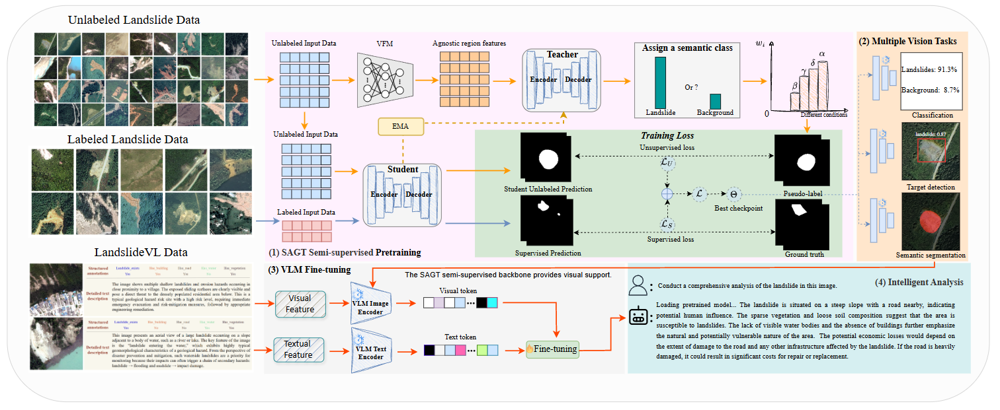

# LandslideFM

The code implementation of the LandslideFM.


### Environment
---
Please run the following script to install the LandslideFM runtime environment.
```
pip install -r requirements.txt
```

### Dataset
---
Download the processed [Datasets](https://huggingface.co/datasets/fluorites/LandslideVL) and [LandslideVL](https://huggingface.co/datasets/fluorites/LandslideVL). Your file structure will be like:
```
├── [Your Dataset Path]
    ├── JPEGImages
        ├── img_001.jpg
        ├── img_002.jpg
        └── ...
    ├── SegmentationClass
        ├── label_001.png
        ├── label_002.png
        └── ...
```
Then place the LandslideVL.csv file in the annotations folder.

### VFM and VLM Pretrained Backbones
---
Download the pretrained [DINOv2](https://github.com/facebookresearch/dinov2), [SAM3](https://github.com/facebookresearch/sam3), [Qwen-VL](https://github.com/QwenLM/Qwen3-VL) and [Kimi-VL](https://github.com/MoonshotAI/Kimi-VL?utm_source=chatgpt.com).
Your file structure will be like:
```
├── pretrained
    └── dinov2_small.pth
    └── ...
```

### Pre-training LandslideFM
---
Please run the following script to pretrain the visual backbone of LandslideFM and obtain the training metrics.
```
sh scripts/train_dataset.sh 4 29501 29502 29503 29504
```

### Fine-tuning LandslideFM
---
Please run the following script to fine-tune the model and obtain the training metrics.
```
sh scripts/fine_tuning_landslidevl.sh 1 29501
```

### Testing LandslideFM
---
Please run the following script to test the model and obtain the evaluation metrics.
```
CUDA_VISIBLE_DEVICES=1 python test.py --config configs/dataset.yaml --checkpoint 'best.pth' 
CUDA_VISIBLE_DEVICES=1 sh scripts/test_landslidevl.sh 1 29501
```

### Determined AI
---
If your laboratory has configured Determined AI, you can run the following script for training.
```
cd det_create
det e create det_H100.yaml .
```

### Acknowledgments
---
We sincerely thank the authors of [Qwen-VL](https://github.com/QwenLM/Qwen3-VL) and [SAM3](https://github.com/facebookresearch/sam3) for their excellent open‑source work.